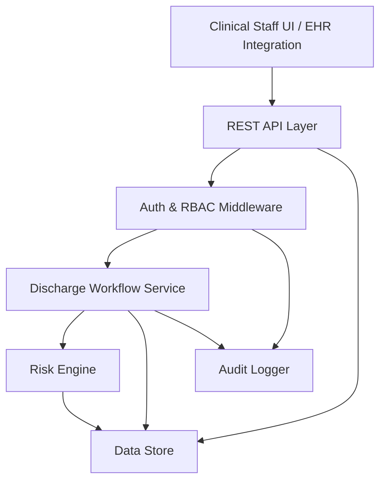

# Design Document: Hospital Readmission Risk Assessment

## Overview

The Hospital Readmission Risk Assessment system is a backend service that integrates into the hospital discharge workflow to compute, store, and surface 30-day readmission risk scores for patients. The system ingests structured patient data at discharge time, runs a risk scoring model, generates a Risk_Report, and exposes the results through a REST API consumed by clinical staff interfaces.

The design prioritizes determinism in scoring, auditability of all data access, and graceful degradation when the risk engine is unavailable — ensuring the discharge workflow is never blocked.

---

## Architecture

The system follows a layered service architecture with clear separation between the API layer, business logic, and data persistence.



### Key Architectural Decisions

- **Synchronous risk computation**: Risk scoring is triggered synchronously during discharge. A 10-second timeout guard ensures the workflow is never blocked indefinitely.
- **Append-only audit log**: The audit log is a separate, write-only collection/table to prevent tampering.
- **Deterministic scoring**: The Risk Engine uses a fixed, versioned scoring model (no stochastic elements) to guarantee reproducibility.
- **Schema validation at API boundary**: All inputs are validated against JSON Schema before reaching business logic.

---

## Components and Interfaces

### 1. REST API Layer

Exposes HTTP endpoints. All endpoints (except health check) require a valid JWT bearer token.

| Method | Path | Description | Roles |
|--------|------|-------------|-------|
| POST | `/discharge/{patientId}/assess` | Trigger risk assessment for a patient | Clinical_Staff, Administrator |
| GET | `/patients/{patientId}/risk-report` | Get most recent Risk_Report | Clinical_Staff, Administrator |
| GET | `/patients/{patientId}/risk-history` | Get all Risk_Reports for a patient | Clinical_Staff, Administrator |
| GET | `/audit-logs` | Query audit log entries | Administrator |
| GET | `/health` | Health check | Public |

### 2. Auth & RBAC Middleware

- Validates JWT tokens on every protected request
- Extracts user identity and role from token claims
- Returns HTTP 401 for missing/invalid tokens
- Returns HTTP 403 for valid tokens with insufficient role

### 3. Discharge Workflow Service

Orchestrates the end-to-end discharge assessment flow:

1. Receive discharge trigger for `patientId`
2. Retrieve and validate `Patient_Record` from Data_Store
3. Submit `Patient_Record` to Risk Engine
4. Receive `RiskResult` (or handle timeout/error)
5. Construct and persist `Risk_Report`
6. Write to Audit_Log
7. Return `Risk_Report` to caller

### 4. Risk Engine

Stateless scoring component. Accepts a validated `Patient_Record` and returns a `RiskResult`.

**Scoring model inputs** (weighted features):
- Age (continuous)
- Number of prior admissions in past 12 months (continuous)
- Length of current stay in days (continuous)
- Primary diagnosis ICD-10 category (categorical)
- Number of active comorbidities (continuous)
- Discharge disposition (categorical: home, SNF, home health, AMA, etc.)
- Number of current medications (continuous)

**Scoring algorithm**: Logistic regression over normalized features with fixed, versioned coefficients. Output is mapped to [0, 100] via sigmoid scaling.

**Factor attribution**: Each feature's contribution to the final score is computed as the product of its normalized value and its model coefficient. The top N factors are returned sorted by absolute contribution.

### 5. Data Store

Persistent storage with three logical collections:

- `patient_records` — source of truth for patient clinical data
- `risk_reports` — all generated Risk_Reports (append-only per patient)
- `audit_logs` — append-only event log

### 6. Audit Logger

A write-only service component. Accepts structured log events and appends them to the `audit_logs` collection. Never exposes a delete or update interface.

---

## Data Models

### PatientRecord

```typescript
interface PatientRecord {
  patientId: string;           // UUID
  age: number;                 // years, integer >= 0
  gender: "M" | "F" | "O";
  primaryDiagnosis: string;    // ICD-10 code, e.g. "I21.0"
  comorbidities: string[];     // array of ICD-10 codes
  lengthOfStay: number;        // days, integer >= 0
  priorAdmissions12m: number;  // count, integer >= 0
  dischargeDisposition: DischargeDisposition;
  medications: string[];       // medication names or codes
  recordedAt: string;          // ISO 8601 timestamp
}

type DischargeDisposition =
  | "home"
  | "home_health"
  | "snf"              // skilled nursing facility
  | "rehab"
  | "ama"              // against medical advice
  | "expired"
  | "other";
```

### RiskResult (internal, from Risk Engine)

```typescript
interface RiskResult {
  patientId: string;
  score: number;               // [0, 100]
  level: "Low" | "Medium" | "High";
  contributingFactors: ContributingFactor[];
  computedAt: string;          // ISO 8601 timestamp
}

interface ContributingFactor {
  feature: string;             // e.g. "priorAdmissions12m"
  value: number | string;      // actual value from record
  contribution: number;        // signed weight contribution
}
```

### RiskReport (persisted and returned via API)

```typescript
interface RiskReport {
  reportId: string;            // UUID
  patientId: string;
  assessedBy: string;          // Clinical_Staff user ID
  score: number;               // [0, 100]
  level: "Low" | "Medium" | "High";
  contributingFactors: ContributingFactor[];
  assessedAt: string;          // ISO 8601 timestamp
}
```

### AuditLogEntry

```typescript
interface AuditLogEntry {
  logId: string;               // UUID
  eventType: "ASSESSMENT" | "DATA_ACCESS";
  patientId: string;
  userId: string;
  endpoint?: string;           // for DATA_ACCESS events
  riskLevel?: "Low" | "Medium" | "High";  // for ASSESSMENT events
  timestamp: string;           // ISO 8601 timestamp
}
```

### API Error Response

```typescript
interface ApiError {
  errorCode: string;           // e.g. "VALIDATION_ERROR", "NOT_FOUND"
  message: string;
  referenceId: string;         // UUID for tracing
  fields?: FieldError[];       // present for 400 errors
}

interface FieldError {
  field: string;
  reason: string;
}
```

---

## Correctness Properties

*A property is a characteristic or behavior that should hold true across all valid executions of a system — essentially, a formal statement about what the system should do. Properties serve as the bridge between human-readable specifications and machine-verifiable correctness guarantees.*

### Property 1: Risk Score is always in range

*For any* valid `PatientRecord`, the Risk Score returned by the Risk Engine SHALL always be a number in the closed interval [0, 100].

**Validates: Requirements 2.1**

---

### Property 2: Risk Level is consistent with Risk Score

*For any* `RiskResult`, the `level` field SHALL be exactly "Low" when `score` is in [0, 39], "Medium" when `score` is in [40, 69], and "High" when `score` is in [70, 100]. No other combinations are valid.

**Validates: Requirements 2.2**

---

### Property 3: Determinism — same input yields same output

*For any* `PatientRecord`, calling the Risk Engine twice with the same record SHALL produce identical `score`, `level`, and `contributingFactors` in both calls.

**Validates: Requirements 2.5**

---

### Property 4: Contributing factors are sorted by descending contribution magnitude

*For any* `RiskResult` with more than one contributing factor, the absolute value of `contribution` for factor at index `i` SHALL be greater than or equal to the absolute value of `contribution` for factor at index `i+1`.

**Validates: Requirements 3.2**

---

### Property 5: Risk Report round-trip persistence

*For any* `RiskReport` that is persisted to the Data_Store, retrieving it by `patientId` via the API SHALL return a report with identical `score`, `level`, `patientId`, and `assessedAt` values.

**Validates: Requirements 3.3, 3.4**

---

### Property 6: Historical reports are ordered by descending timestamp

*For any* patient with multiple `RiskReport` records, the list returned by the history endpoint SHALL be ordered such that `assessedAt` at index `i` is greater than or equal to `assessedAt` at index `i+1`.

**Validates: Requirements 5.2**

---

### Property 7: Historical report count is accurate

*For any* patient, the `count` field in the history response SHALL equal the length of the returned `reports` array.

**Validates: Requirements 5.3**

---

### Property 8: Unauthenticated requests are always rejected

*For any* protected API endpoint, a request without a valid JWT token SHALL always receive an HTTP 401 response, regardless of the request body or path parameters.

**Validates: Requirements 6.1, 6.2**

---

### Property 9: Audit log is append-only

*For any* sequence of assessment and data access events, the total number of audit log entries SHALL be monotonically non-decreasing. No existing entry SHALL be modified after creation.

**Validates: Requirements 7.3**

---

### Property 10: Validation rejects malformed records

*For any* `PatientRecord` with at least one field that violates its type or value constraint (e.g., negative age, invalid ICD-10 format, score out of range), the system SHALL return a structured error identifying the offending field and SHALL NOT produce a Risk Score.

**Validates: Requirements 1.3, 1.4, 8.1, 8.3**

---

## Error Handling

| Scenario | Component | Behavior |
|----------|-----------|----------|
| Missing required field in PatientRecord | Discharge Workflow | Return 400 with `FieldError` listing missing field |
| Invalid ICD-10 code format | Discharge Workflow | Return 400 with `FieldError` |
| Risk Engine timeout (> 10s) | Discharge Workflow | Notify staff, allow discharge to proceed, log timeout event |
| Risk Engine internal error | Risk Engine | Return structured `RiskEngineError` with error code |
| Patient not found | API | Return 404 with `ApiError` |
| No risk report found | API | Return 404 with `ApiError` (errorCode: "NOT_FOUND") |
| Unauthenticated request | Auth Middleware | Return 401 |
| Insufficient role | Auth Middleware | Return 403 |
| Unexpected server error | API | Return 500 with `ApiError` including unique `referenceId` |

---

## Testing Strategy

### Dual Testing Approach

Both unit tests and property-based tests are required. They are complementary:
- **Unit tests** validate specific examples, edge cases, and integration points
- **Property tests** validate universal correctness across a wide range of generated inputs

### Property-Based Testing

**Library**: `fast-check` (TypeScript/JavaScript) or `hypothesis` (Python) — chosen based on implementation language.

Each property test MUST run a minimum of **100 iterations**.

Each test MUST be tagged with:
> `Feature: hospital-readmission-risk, Property {N}: {property_text}`

| Property | Test Description |
|----------|-----------------|
| Property 1 | Generate random valid PatientRecords; assert score ∈ [0, 100] |
| Property 2 | Generate random scores; assert level matches threshold rules |
| Property 3 | Generate random PatientRecords; call engine twice; assert outputs are equal |
| Property 4 | Generate random RiskResults; assert factors are sorted by descending |contribution| |
| Property 5 | Generate random RiskReports; persist then retrieve; assert field equality |
| Property 6 | Generate random sets of RiskReports; assert history is sorted descending by timestamp |
| Property 7 | Generate random history responses; assert count == reports.length |
| Property 8 | Generate random requests to protected endpoints without tokens; assert 401 |
| Property 9 | Generate random event sequences; assert audit log length is non-decreasing |
| Property 10 | Generate invalid PatientRecords; assert 400 response with field error, no score produced |

### Unit Tests

Focus on:
- Specific ICD-10 code validation examples (valid and invalid formats)
- Boundary values for Risk Level thresholds (scores 39, 40, 69, 70)
- Discharge disposition edge cases (AMA, expired)
- Empty comorbidities and medications arrays
- Timeout behavior when Risk Engine exceeds 10 seconds
- High-risk care plan prompt trigger
- Audit log entries for assessment and data access events
- Administrator-only audit log endpoint access
- 404 response for unknown patient identifiers
